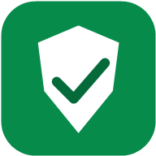
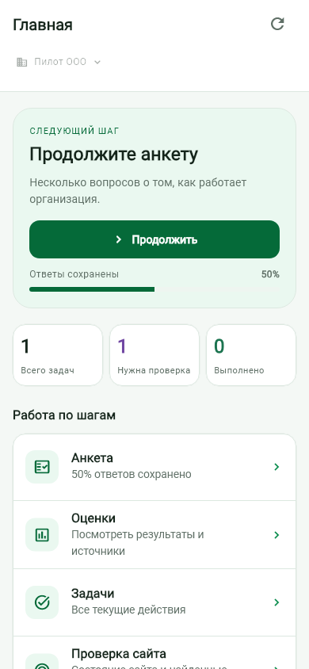
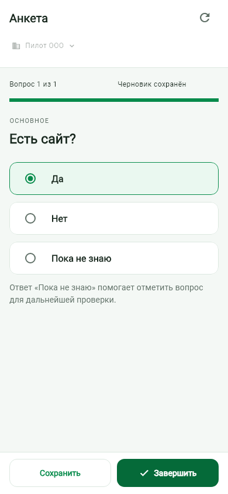
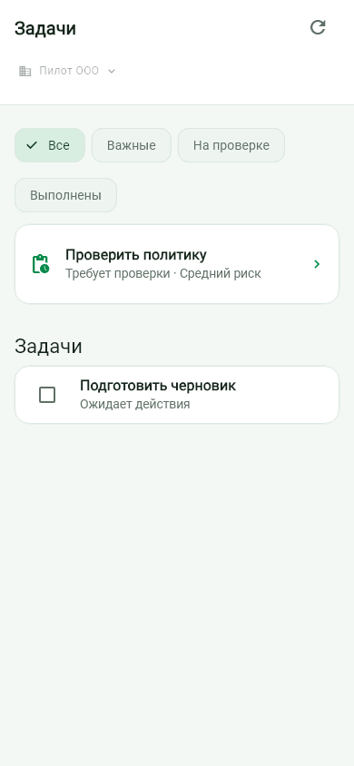

  

<h1 align="center">Compliance Navigator for Android</h1>

Company details, questionnaires and personal data tasks, wherever you work.

  <strong>English</strong> · <a href="README.ru.md">Русский</a> 
  <a href="https://compliance-pilot.ms777.ru/">Web pilot</a> ·
  <a href="https://compliance-pilot.ms777.ru/android/">Android APK</a> ·
  <a href="https://github.com/ub3dqy/ComplianceNavigato-Android/issues">Ideas &amp; feedback</a>

Compliance Navigator helps small businesses in Russia organise their work with personal data. Add a company, describe how it handles information, and use the results to work through tasks, documents and supporting evidence.

This repository contains the Android app. It connects to the hosted pilot, where access is by invitation. You can manage several organisations and switch between them as you work. Server source and server setup instructions are maintained separately.

## What you can do

- **Keep company profiles together.** Add companies and sole traders, edit their details and choose the organisation you are working with. Optional INN lookup fills in public company details when DaData is configured on the server.
- **Fill in the questionnaire at your own pace.** Save your progress and return later. “I don't know” marks a point for follow-up.
- **Work through tasks.** See what needs attention, track deadlines and attach evidence to completed work.
- **Review your public websites.** Check authorised pages for signs of forms, privacy information and other points that need a closer look.
- **Prepare documents and reports.** Generate drafts, keep supporting files and export reports in HTML, DOCX or JSON.
- **Control access.** Organisation membership and roles govern access to records and files. The activity history helps you follow changes.

Results come from versioned rules with references to official sources. Check their applicability and review document drafts before using them. The current scope is personal data in Russia; other areas of business compliance are outside this module.

An optional assistant can explain results and suggest next steps. The main workflows work without it.

## A look inside

<table>
  <tr>
    <td align="center"><strong>Overview</strong></td>
    <td align="center"><strong>Questionnaire</strong></td>
    <td align="center"><strong>Tasks</strong></td>
  </tr>
  <tr>
    <td></td>
    <td></td>
    <td></td>
  </tr>
</table>

*Android screens with fictional example data. Light, dark and system themes are available. The interface is currently in Russian.*

## Get the app

Download the current pilot APK from the [Android download page](https://compliance-pilot.ms777.ru/android/). An invitation is required to sign in. The app checks for updates in its settings and when you return to it; installation requires your confirmation.

## Build and test

The Flutter project is in `mobile/`. Use the exact stable Flutter version in `mobile/.flutter-version` and the JDK version in `mobile/.java-version`. The [development guide](docs/development.md) covers setup, local checks and a debug build. Tests use fictional data and do not need a running server.

The two JSON documents in `docs/` describe the client API contract and visual design. They contain no server implementation. Signing keys, accounts and company records are not included.

## Suggestions are welcome

We welcome advice, feature requests and suggestions for improving the app. If something is confusing or a routine task takes too many steps, tell us about it. Examples from your own work are especially useful.

[Open an issue](https://github.com/ub3dqy/ComplianceNavigato-Android/issues/new) to suggest a feature or report a problem. Improvements to the wording, translations, interface and documentation are welcome too. For a larger change, describe the idea first so we can agree on its scope.

Please use fictional data in examples and screenshots. Leave out passwords, tokens and information about real people.

**Dima Mak · [@ub3dqy](https://github.com/ub3dqy)**
